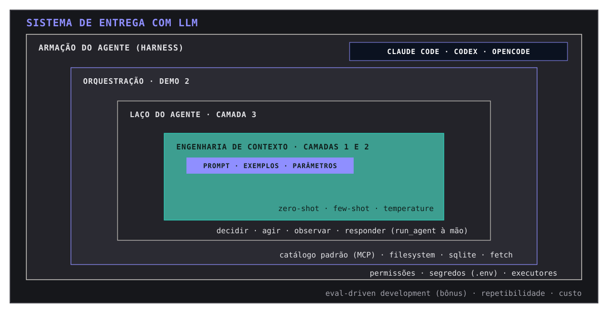
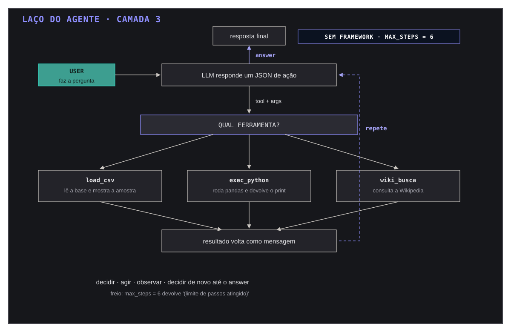
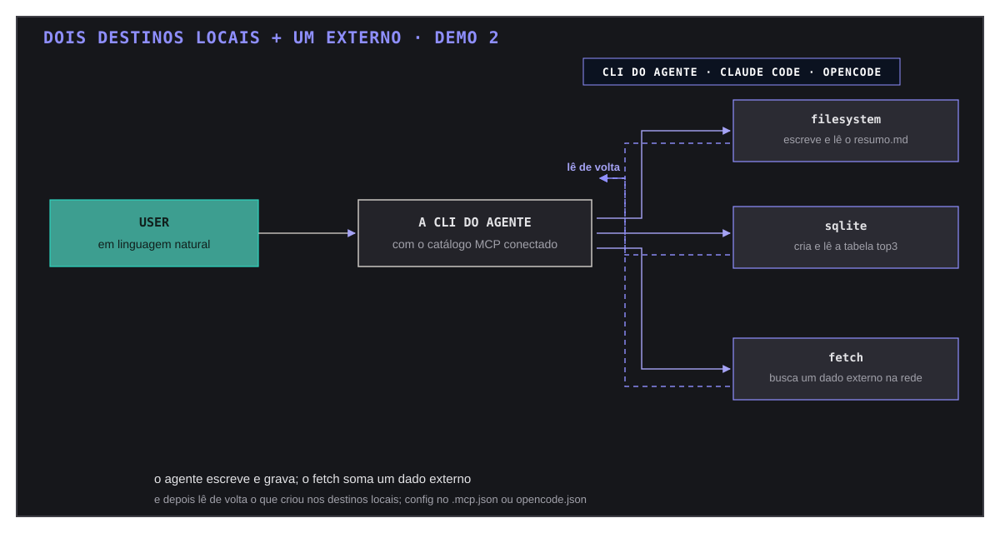

# IA Hands-on: da engenharia de prompt ao agente

Material prático, nascido de uma sessão ao vivo e pensado para ser
re-executado por você. A narrativa: da engenharia de prompt ao agente,
visto por dentro, com dados de verdade.

Tese central: o modelo é uma peça substituível - trocar de provedor é
editar três linhas do .env; a engenharia que permanece é prompt,
exemplos, ferramentas e avaliação.

Cada notebook é auto-contido: rode na ordem, pule para o que interessar
ou vá direto às intervenções "Experimente você".

## O mapa das camadas

Todo o material cabe nestas caixas aninhadas (adaptado do diagrama
"agentic delivery system" do ecossistema de agentes; a versão à frente
usa os nomes das nossas camadas):



| Camada do desenho | Onde aparece | Arquivo |
|---|---|---|
| Engenharia de contexto (teal) | zero-shot (camada 1) e few-shot (camada 2): tudo que entra na janela do modelo | demo-1/01, demo-1/02 |
| Laço do agente | o run_agent à mão: decidir, agir, observar, responder | demo-1/03 |
| Orquestração | ferramentas coordenadas por um catálogo padrão (MCP): filesystem, sqlite, fetch | demo-2 |
| Armação (harness) | a CLI do agente que conecta tudo: Claude Code ou OpenCode, permissões, segredos | demo-2/.mcp.json, .env |
| Envelope (evals, custo) | como saber que funciona sem achar: suíte com gabarito | demo-1/bonus_evals |

### A lógica de dentro para fora

1. **Contexto** é tudo que você escreve na janela: prompt, exemplos,
   parâmetros. As camadas 1 e 2 mostram o placar mudar só com isso.
2. **Laço** é o que o agente faz a cada volta: um JSON de ação, uma
   tool executada, o resultado voltando como mensagem, até o answer.
3. **Orquestração** é quando as ferramentas não são mais as suas: um
   catálogo padrão (MCP) entrega o filesystem, o banco e a rede.
4. **Armação** é a casa: a CLI do agente, as permissões, o .env com as
   chaves, o custo por chamada.
5. **Envelope** é o julgamento: avaliar contra um gabarito e repetir
   para medir repetibilidade (a camada bônus).

### O laço do agente (camada 3) em um grafo



O `max_steps=6` do run_agent é a trava para nunca girar de verdade:
sem framework, mas com freio (aponta no desenho).

## Critério de parada: quando a chamada continua, quando para

Terminar no lugar certo é parte do design. No material, a parada
acontece em quatro níveis - e todos são visíveis (nenhum escondido
dentro de framework):

| Nível | Quem decide | Onde ler no código |
|---|---|---|
| O modelo decide acabou | o turno com `{"answer": ...}` encerra o laço; só uma `tool` gera a próxima volta | demo-1/03, `run_agent`: `if 'answer' in acao: return` |
| O freio (guardrail) | o teto de voltas protege do agente perdido; estourou, devolve `'(limite de passos atingido)'` | demo-1/03, `run_agent(..., max_steps=6)` |
| A resposta em si | `finish_reason` da API: `stop` concluiu; `length` = orçamento de tokens estourou (o `llm.py` levanta erro com conteúdo vazio) | llm.py, bloco `if not content` |
| A infraestrutura | 429 do free tier: até 4 tentativas com backoff; persistindo, o erro sobe | llm.py, bloco retry |

A intuição que vale levar: o custo da parada errada é assimétrico.
Parar cedo demais entrega resposta vazia; parar tarde demais entrega
conta (tokens e giros). O `max_steps` nunca é conveniência: é política
de custo.

### Um dado, três destinos (demo 2)



## Estrutura

```
podcast-ia-hands-on/
  Makefile                setup re-executavel: make setup/env/test/notebooks/evals
  pyproject.toml          dependencias declaradas (gerenciadas pelo uv)
  uv.lock                 lock das dependencias (instalacao reprodutivel)
  llm.py                  helper agnóstico (padrão OpenAI-compat) + retry 429
  .env.example            template de credenciais -> copie para .env
  LICENSE                 MIT: replique, teste e faça fork à vontade
  data/reclamacoes.csv    dataset de demo (18 linhas, 5 categorias)
  diagramas/              os 3 SVGs deste README (mesmo padrão visual)
  demo-1/                 Demo 1 - da engenharia de prompt ao agente
    01_zero_shot.ipynb    camada 1: classificador zero-shot, falha ao vivo
    02_few_shot.ipynb     camada 2: poucos exemplos + micro-tuning
    03_agent_loop.ipynb   camada 3: o laço do agente escrito à mão
    bonus_evals.ipynb     camada 5 (bônus): eval-driven development
  demo-2/                 Demo 2 - top-3 MCPs criando e lendo em destinos
    .mcp.json.example     template dos 3 servers MCP (o gerado vem de make demo2-config)
    roteiro-demo-2.md     passo a passo da demonstração ao vivo
```

## Setup

Tudo via `make`, com dependências gerenciadas pelo `uv` (Python 3.10+
instalado automaticamente se necessário). Para instalar o `uv` (se não
tiver): `curl -LsSf https://astral.sh/uv/install.sh | sh`.

1. Preparar o ambiente (cria `.venv` e instala do lock):
   ```
   make setup
   ```
2. Criar o `.env` a partir do template (não sobrescreve um existente)
   e preencher:
   ```
   make env
   ```
   - `LLM_API_KEY` - chave do provedor
   - `LLM_MODEL` - nome do modelo
   - `LLM_BASE_URL` - base do endpoint (padrão OpenAI-compatible)
   - OpenCode Go (recomendado):
     `https://opencode.ai/inference/go/openai/v1/` com um modelo free
     (ex.: `minimax-m3.1-flash-free`); key em https://opencode.ai/console
   - OpenRouter: `https://openrouter.ai/api/v1/` com um modelo `:free`
     (a lista muda com frequência: ver https://openrouter.ai/models);
     key em https://openrouter.ai/settings/keys
   - Gemini free: `https://generativelanguage.googleapis.com/v1beta/openai/`
     com `gemini-2.5-flash-lite` (~1.000 req/dia no free tier; evite os
     flash "padrão", ~20 req/dia e trava no meio do roteiro)
   - OpenAI: `https://api.openai.com/v1/`
3. Testar o caminho feliz (consome uma chamada pequena):
   ```
   make test
   ```
4. Abrir os notebooks (demo 1):
   ```
   make notebooks
   ```
5. Rodar a suíte de evals com gabarito (gasta chamadas da API por
   design; sai em `export/bonus_evals.ipynb`):
   ```
   make evals
   ```
6. Para a demo 2: node/npx instalados (server filesystem via `npx -y`)
   e `uv tool install mcp-server-fetch mcp-server-sqlite` (comandos no
   PATH). Gerar o config dos MCP servers com o caminho da sua pasta:
   ```
   make demo2-config
   ```

## Passo a passo

Siga na ordem; cada passo depende só do setup e do `.env`.

| Passo | Notebook | O que acontece | Experimente você |
|---|---|---|---|
| 1. Zero-shot | demo-1/01 | classificador sem exemplos: erra as armadilhas | trocar o índice de uma linha no CSV e reexecutar |
| 2. Few-shot | demo-1/02 | 4 âncoras mudam o placar; o erro da linha 16 resiste | comentar uma âncora e ver a linha regredir |
| 2b. Micro-tuning | demo-1/02 | 4 configs x 3 rodadas: parâmetros não consertam | adicionar outra configuração à lista |
| 3. Agente à mão | demo-1/03 | o laço decidir/agir/observar sem framework | perguntar outra coisa que use a terceira tool (Wikipedia) |
| 4. MCP | demo-2 | mesmo dado indo e voltando por 3 destinos | subir no Claude Code/OpenCode e trocar a pergunta |
| 5. Evals (bônus) | demo-1/bonus_evals | suíte com gabarito: score por prompt | descomentar a suíte few-shot e comparar |

Resultado empírico validado em rodadas repetidas:
- linhas 15 e 16 do CSV: armadilhas multimotivo; zero-shot erra sempre;
- linhas 15 e 17 consertam de forma estável com os 4 exemplos few-shot;
- linha 16: propositalmente sem âncora - o micro-tuning não salva
  (placar 6/9 em qualquer configuração de amostragem); o exemplo novo
  salva. É a lição central da camada 2.

## Dicas de execução

- O `llm.py` já faz retry com backoff no 429 - a mensagem de espera em
  tela é conteúdo, não bug ("quotas são reais").
- Tudo roda localmente; a única dependência externa é a API de LLM.

## Síntese por camada

1. Zero-shot: o modelo não é mágica, é um prompt. Quando erra, o
   conserto não é trocar de modelo - é dar mais contexto.
2. Few-shot: quatro exemplos custam quatro linhas e mudam o placar.
   Dados de qualidade vencem modelo maior quase sempre.
3. Agente: o laço decidir, agir via ferramenta, observar, repetir é
   todo o segredo; qualquer framework é uma variação disso.
4. MCP: configurar em minutos o que à mão custa semanas; o protocolo
   padroniza a parte chata - inclusive o teste de integração.
5. Evals: como saber que funciona sem achismo? Rode a suíte: o TDD do
   mundo não-determinístico.

## Licença

MIT: use, replique, teste e faça fork à vontade. Créditos são
bem-vindos mas não são exigidos - o material é para exercitar.
